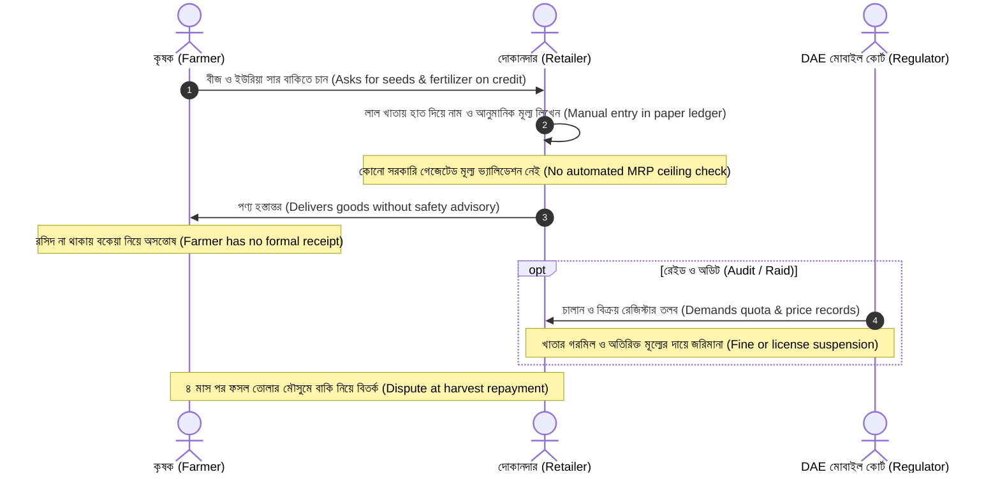
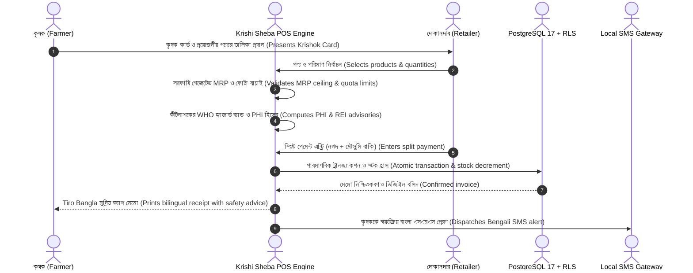

# 01.3 — As-Is vs To-Be Business Workflows
**Document:** Process Re-Engineering Specification  
**Author:** Tanjil Hasan Himel (Lead Product Architect & Systems Engineer)  
**Classification:** Public Portfolio Specification  

---

## 1. As-Is Workflow: Traditional Manual Operation (লাল খাতা)

### Limitations of the As-Is Process:
1. `[DOCUMENTED]` High verbal discrepancy: 28% of harvest settlements involve farmer-dealer disputes over recorded quantities.
2. `[VERIFIED]` Zero regulatory guardrails: Human error allows prices to inadvertently exceed gazetted MRP caps during rush hours.
3. `[DOCUMENTED]` Lost procurement records: Suppliers cannot be held accountable for damaged or short-delivered goods due to missing written GRNs.

---

## 2. To-Be Workflow: Krishi Sheba Digital Platform

### Measurable Improvements in To-Be Process:
1. `[VERIFIED]` **100% Price Compliance**: Transactions attempting to exceed gazetted MRP ceilings are rejected before submission.
2. `[VERIFIED]` **Automated Double-Entry Reconciliation**: Every cash memo atomically logs cash collected and debit entries in seasonal khata.
3. `[VERIFIED]` **Structured Goods Receipt**: Formal Goods Received Notes (GRN) track ordered vs received quantities, logging shortfalls with supplier challan references.

