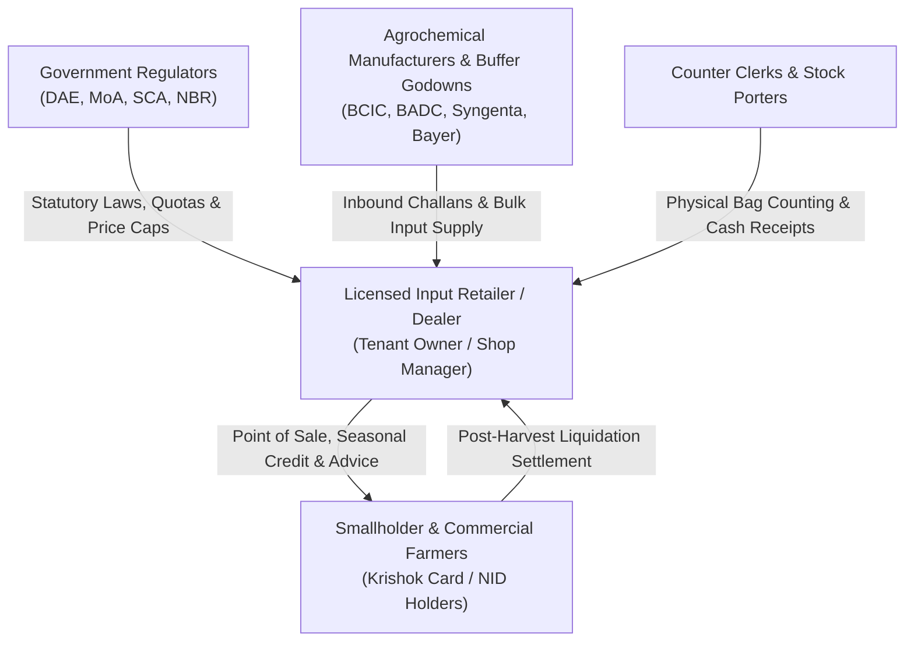

# 01.2 — Stakeholder Analysis & User Personas
**Document:** Stakeholder Matrix & Persona Architecture  
**Author:** Tanjil Hasan Himel (Lead Product Architect & Systems Engineer)  
**Classification:** Public Portfolio Specification  

---

## 1. Stakeholder Ecosystem Map

---

## 2. Key Stakeholder Personas & Roles

### Persona 1: মোঃ তানজিল হাসান — Dealership Owner & Primary Tenant
- **Role:** Retail Input Business Owner (`tenant_owner`)
- **Location:** Sherpur Upazila, Bogura District
- **Context:** Operates a 2-counter agricultural store with ৳1.5 Crore annual turnover. Sells subsidized fertilizers, hybrid seeds, and plant protection chemicals.
- **Pain Points:**
  - Cash-flow dry spells during planting when farmers take 70% of inventory on credit.
  - Constant fear of Directorate of National Consumer Rights Protection (DNCRP) raids over price differences.
  - Manual paper ledgers get torn, smudged, or disputed by farmers at harvest time.
- **Key Needs:**
  - Automated price ceilings that prevent counter clerks from overcharging.
  - Real-time visibility into total outstanding dues by crop season (Boro vs Aman).
  - Single-click SMS balance summaries sent directly to farmer mobile phones.

### Persona 2: আব্দুল করিম — Store Manager & Counter Cashier
- **Role:** Store Operations & POS Clerk (`store_manager` / `sales_clerk`)
- **Context:** Fast-paced counter rush between 7:00 AM and 11:00 AM when dozens of farmers arrive to purchase fertilizer bags before planting.
- **Pain Points:**
  - Complex manual math on split payments (part cash, part bKash, remainder added to seasonal khata).
  - Forgetting to warn farmers about dangerous pesticide re-entry intervals (REI).
- **Key Needs:**
  - Rapid, keyboard-friendly checkout with clear Bengali numerals (Tiro Bangla).
  - Automated split payment calculations.
  - Printed cash memos with official safety advisories.

### Persona 3: করিম মিয়া (হাজী) — Marginal Rice Farmer & Borrower
- **Role:** Customer / Beneficiary (`customer`)
- **Context:** Farms 4 bighas of Boro paddy in Chakpara village. Owns a Krishok Card (কার্ড নং: KC-BOG-2024-8891).
- **Pain Points:**
  - Cannot pay upfront during land preparation; relies entirely on the dealer's trust.
  - Loses paper receipts; frequently disputes verbal dues at harvest.
- **Key Needs:**
  - Transparent record of borrowed seeds and fertilizers with exact dates.
  - Repayment schedule tied to crop harvest (May 2026), not calendar months.
  - Transparent SMS confirmation of balance repayments.

### Persona 4: উপসহকারী কৃষি কর্মকর্তা (SAAO) — DAE Regulatory Inspector
- **Role:** External Statutory Auditor (`regulatory_auditor`)
- **Context:** Visits dealerships monthly to audit buffer godown fertilizer quotas, check seed expiration dates, and inspect dealer trade licenses.
- **Pain Points:**
  - Retailers often maintain duplicate paper ledgers to disguise black-market diversion.
- **Key Needs:**
  - Immutable digital audit log of fertilizer sales matched against BCIC delivery challans.

