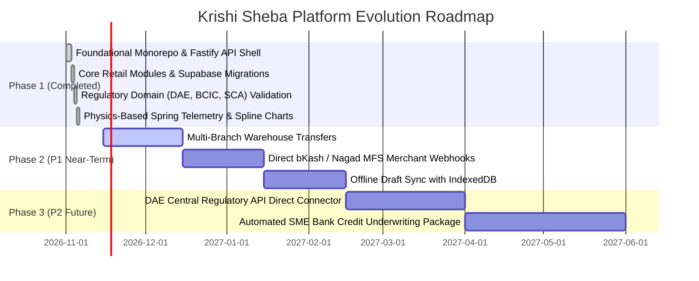

# 02.3 — Product Roadmap & Evolution Strategy
**Document:** Product Roadmap & Milestones  
**Author:** Tanjil Hasan Himel (Lead Product Architect & Systems Engineer)  
**Classification:** Canonical Public Portfolio Specification  

---

## 1. Release Timeline & Milestone Status

---

## 2. Milestone Breakdown

### Phase 1: SaaS Core & Regulatory Integrity `[VERIFIED / SHIPPED]`
- Multi-tenant dealership onboarding and DAE license recording.
- BCIC subsidized fertilizer price ceiling and quota consumption tracking.
- WHO pesticide toxicity classification (Red/Yellow/Blue/Green), PHI, and REI advisories.
- SCA certified seed germination rate verification (80% minimum viability threshold).
- Farmer seasonal khata book structured around biological harvest credit cycles.
- End-of-day cash drawer balancing, denomination counters, and Z-reports.
- 304 automated tests with 100% pass rate.

### Phase 2: Operations Scale & Payment Integration `[PROPOSED]`
- Multi-godown inventory transfers with transit gate passes.
- Direct automated webhooks for bKash and Nagad payment reconciliation.
- Offline-first draft creation using browser IndexedDB for rural areas with intermittent connectivity.

### Phase 3: National Institutional Integration `[PROPOSED]`
- Direct government API gateway integration with DAE and MoA quota databases.
- One-click verified financial statement export for SME bank loan applications.

