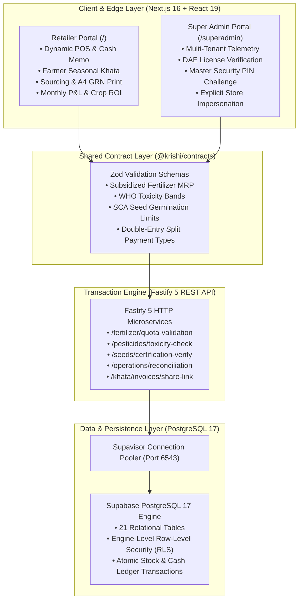

# 03.1 — System Architecture & Topology
**Document:** Technical Architecture & Component Topology  
**Author:** Tanjil Hasan Himel (Lead Product Architect & Systems Engineer)  
**Classification:** Canonical Public Portfolio Blueprint  

---

## 1. System Topology & C4 Architecture



---

## 2. Multi-Tenancy & Zero-Trust RLS Policies

Data isolation is guaranteed at the database engine level. Every business table includes a `tenant_id` foreign key referencing the store's legal entity:

```sql
-- Production RLS Policy: Tenant Isolation for Sales Records
ALTER TABLE public.sales ENABLE ROW LEVEL SECURITY;

CREATE POLICY "Tenant isolation for sales records"
  ON public.sales
  FOR ALL
  USING (tenant_id = auth.jwt() ->> 'tenant_id')
  WITH CHECK (tenant_id = auth.jwt() ->> 'tenant_id');
```

- Even if an API query omits an application-level filter, PostgreSQL enforces row isolation during execution.
- Super admin queries utilize a segregated administrative role with explicit cryptographic validation, ensuring normal merchants cannot access central telemetry.

---

## 3. UI/UX Physics & Micro-Interactions

### A. Harmonic Spring Oscillator (`useSpring`)
Replaces linear animations with physical spring mechanics. Modeled as a second-order ordinary differential equation (ODE):
$$m \cdot \ddot{x} + c \cdot \dot{x} + k \cdot (x - x_{\text{target}}) = 0$$
Using critical damping ($\zeta = 1.0$), numerical balance updates settle smoothly without visual jar, overshoot, or coordinate explosion under rapid user interactions.

### B. Sub-Pixel Catmull-Rom Splines
Converts discrete historical financial balances into sub-pixel smooth SVG path curves (`M ... C ...` cubic Beziers), eliminating unnatural polynomial spikes across unevenly spaced time intervals.

### C. Volume-Preserving Liquid Deformation (`useGooScale`)
Preserves continuous 2D area during elastic pull-to-refresh gestures via the geometric invariant:
$$\text{scaleY} \times \text{scaleX}^2 = 1.0$$
Accompanied by Web Audio API synthesized water droplet acoustic feedback for organic tactile confirmation.

