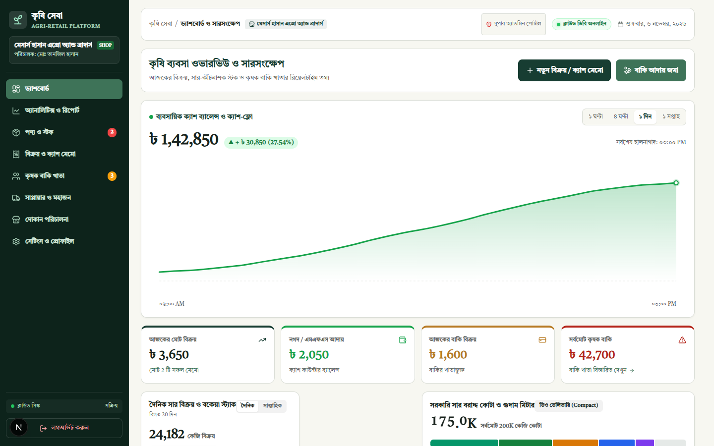
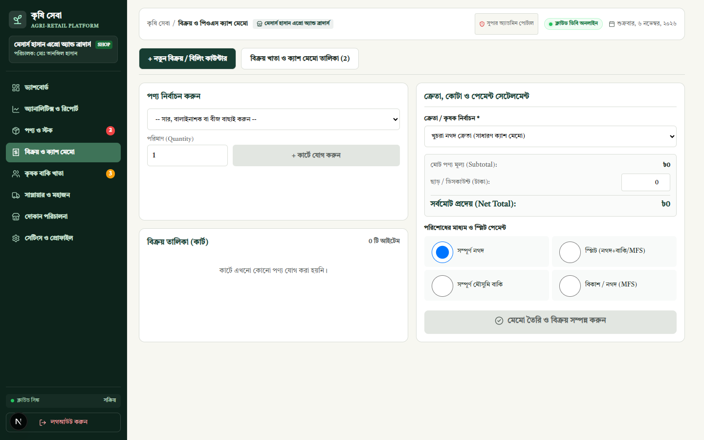
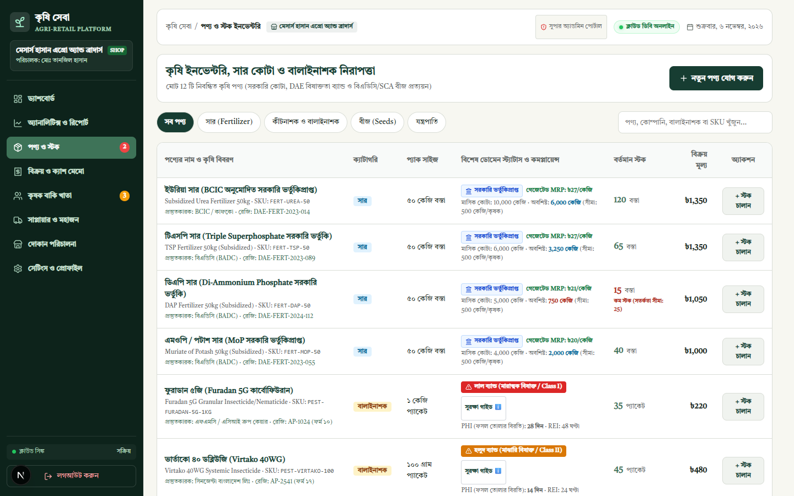
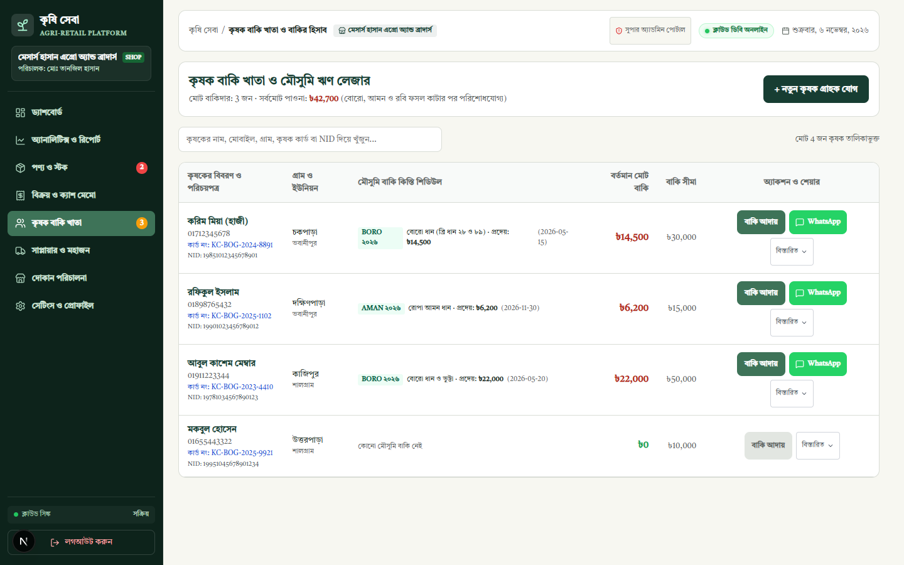
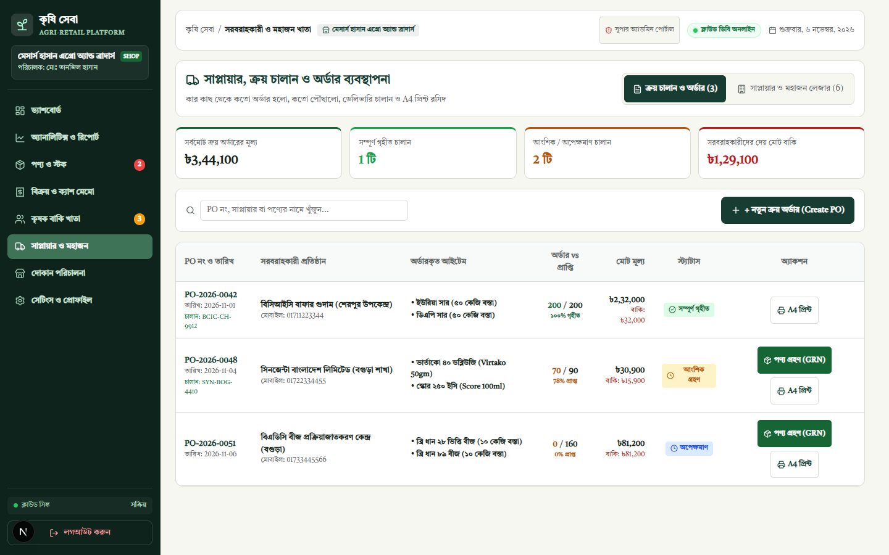
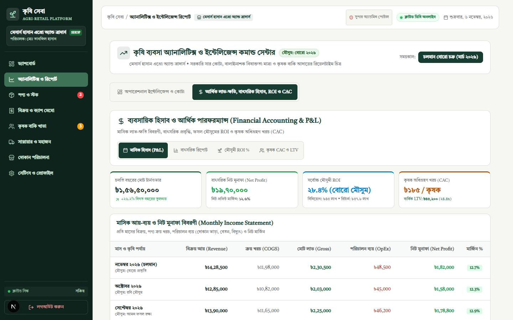
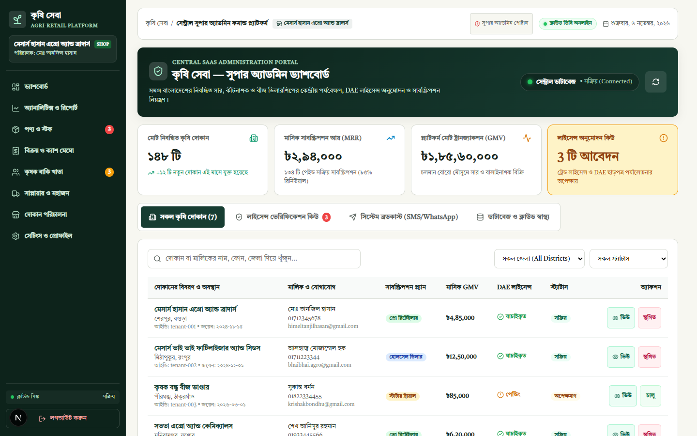

# Engineering Case Study: Krishi Sheba (কৃষি সেবা)

## Executive Summary
**Krishi Sheba** is an agricultural retail management platform designed to solve operational, regulatory, and credit challenges faced by fertilizer, pesticide, and seed input dealers across rural Bangladesh.

---

## 1. Problem Statement
Agricultural input retailers in Bangladesh operate in a high-stakes, tightly regulated, and cash-strained environment:
1. **Strict Regulatory Compliance**: The Bangladesh Pesticide Act (2018) and Fertilizer Management Act (2006) mandate exact record-keeping of government-subsidized fertilizer quotas and hazardous pesticide toxicity classifications. Retailers face fines or license cancellation for non-compliance.
2. **Seasonal Credit Cycles (বাকি খাতা)**: Farmers purchase seeds and fertilizers on credit at planting and repay after harvest (3-5 months later). Conventional 30-day accounting software misclassifies these healthy agricultural credit cycles as overdue debt.
3. **Supply Chain Discrepancies**: Sourcing from buffer godowns (BCIC) or multinational distributors (Syngenta, Bayer) involves frequent partial deliveries, lost challans, and manual gate-pass reconciliation.

---

## 2. Technical Architecture & Decisions

| Decision | Rationale |
|---|---|
| **Next.js 16 + Fastify 5 Monorepo** | Combines server-side rendering and static compilation for the merchant dashboard with low-latency Fastify APIs for transactional endpoints. |
| **Supabase PostgreSQL 17 + RLS** | Enforces strict multi-tenant row-level security so one dealer never accesses another dealer's inventory or customer credit book. |
| **Damped Spring Mechanics (`useSpring`)** | Replaced jarring digital step counters with smooth harmonic oscillation, improving visual balance monitoring during peak counter rushes. |
| **Catmull-Rom to Cubic Bezier Conversion** | Smoothly interpolates seasonal sales trends without unnatural polynomial overshoot. |
| **Tiro Bangla Typography** | Provides authentic Bengali glyphs optimized for official print receipts and numerals. |

### Visual Verification Gallery

| Point of Sale & Regulatory Engine | Agrochemical Inventory & Quota Bounds |
| :---: | :---: |
|  |  |
| **Farmer Khata & Seasonal Harvest Cycles** | **Procurement & Goods Receipt Notes (GRN)** |
|  |  |
| **Periodic Financial Accounting & P&L** | **Central Super Admin Command Center** |
|  |  |

---

## 3. Results & Verified Capabilities
- **100% Passing Test Suite**: 304 automated tests spanning regulatory constraints, double-entry ledgers, and numerical physics stability.
- **A4 Purchase Order & GRN Printing**: Instant print generation with DAE license numbers and dual signature authorization blocks.
- **Farmer Unit Economics**: Measured CAC (৳১৮৫) against annual LTV (৳৪৫,২০০), establishing a 24.4x lifetime value ratio for retail input dealerships.
- **Zero-Secret Public Repository**: Clean commit history suitable for open portfolio demonstration.
