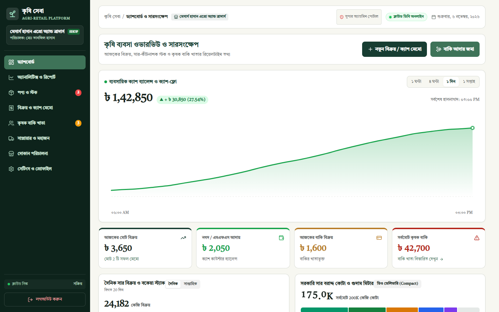
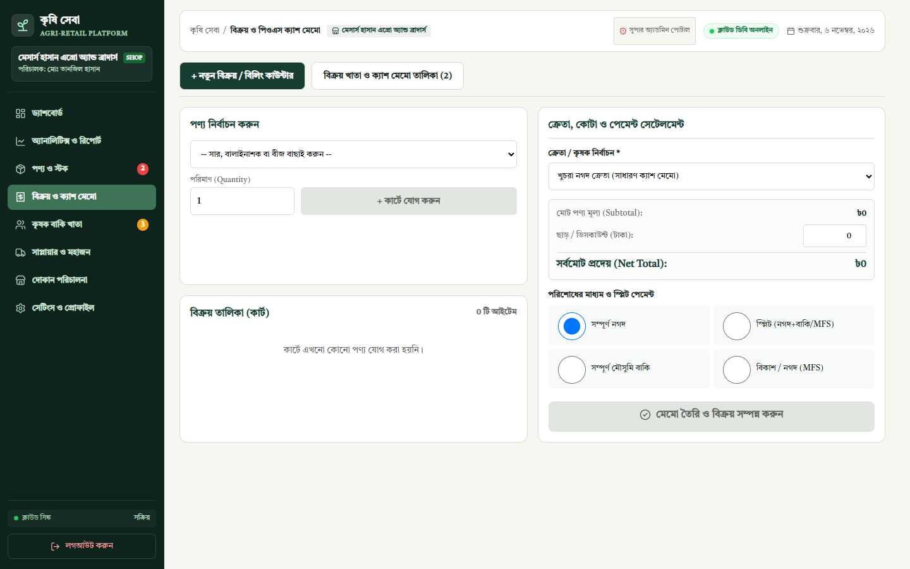
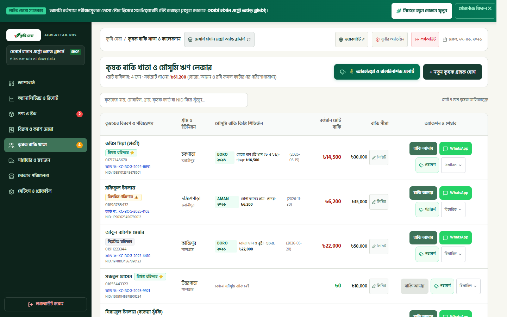
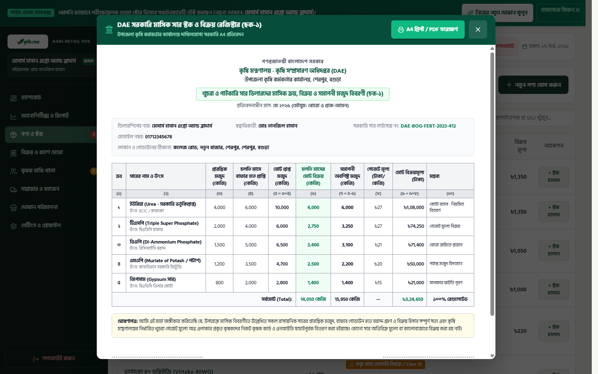
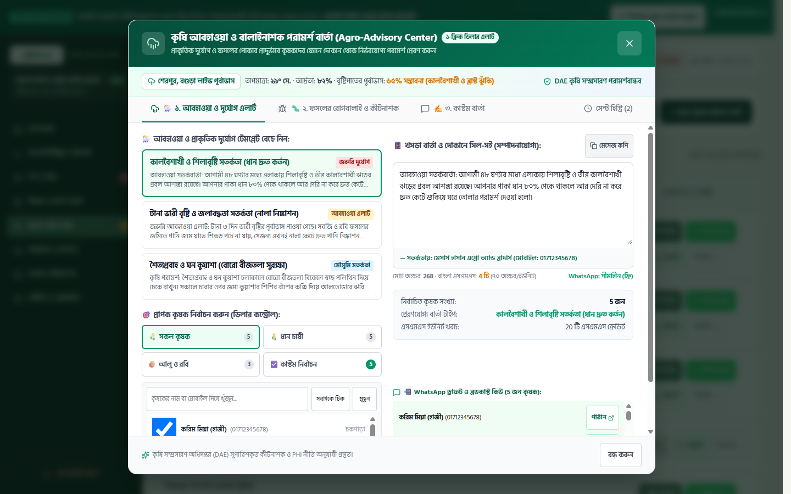
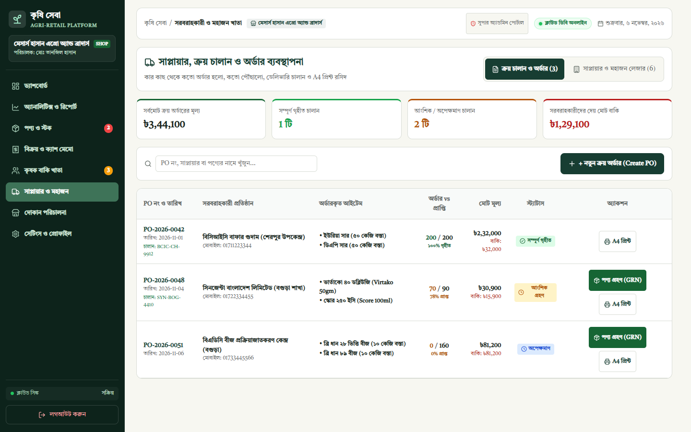
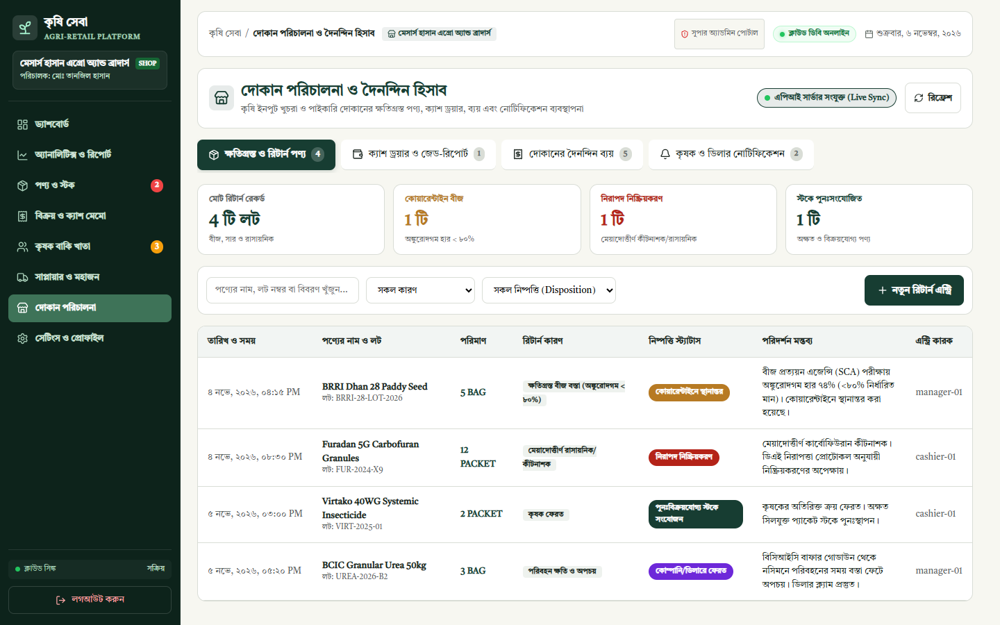

# Krishi Sheba (কৃষি সেবা) — Multi-Tenant Agricultural Retail ERP, Regulatory POS & Financial Platform

[-059669?style=for-the-badge&logo=vitest&logoColor=white)](https://github.com/TanjilHasan-Himel/khrisiSheba-saas-pos-casestudy)
[](https://github.com/TanjilHasan-Himel/khrisiSheba-saas-pos-casestudy)
[](https://github.com/TanjilHasan-Himel/khrisiSheba-saas-pos-casestudy)
[](https://github.com/TanjilHasan-Himel/khrisiSheba-saas-pos-casestudy)
[](https://github.com/TanjilHasan-Himel/khrisiSheba-saas-pos-casestudy)
[](https://github.com/TanjilHasan-Himel/khrisiSheba-saas-pos-casestudy)

**Krishi Sheba (কৃষি সেবা)** is a production-grade, multi-tenant software-as-a-service (SaaS) and retail operations ERP engineered specifically for agricultural input dealers (subsidized fertilizers, toxic agrochemicals, certified seeds, and farm machinery) across Bangladesh.

Serving a national market turnover exceeding **৳35,000 Crore ($3.2B USD)**, the platform replaces informal, paper-based "Red Khatas" with an automated operational engine that guarantees strict statutory compliance with the **Fertilizer Management Act (2006)**, the **Pesticide Act (2018)**, the **Seed Act (2018)**, and official Department of Agricultural Extension (DAE) gazette circulars.

---

> **Notice**: Application source code and deployment infrastructure reside in a private repository. This repository contains the public specifications, architecture diagrams, test results, and case study documents for **Krishi Sheba (কৃষি সেবা)**.

---

## Documentation Index

| Discipline | Deliverables | Directory |
|---|---|---|
| Business Analysis | BRD, market analysis, problem register, RTM | [01-business-analysis/](./01-business-analysis/) |
| Product Management | PRD, personas, user stories, roadmap | [02-product-management/](./02-product-management/) |
| Software Engineering | Monolith TRD, C4 diagrams, PostgreSQL schema, QA audit | [03-software-engineering/](./03-software-engineering/) |
| Decisions & Research | ADRs, DAE statutory notes, post-mortem | [04-research-and-decisions/](./04-research-and-decisions/) |
| Review & Compliance | 10-rule verification sign-off | [publish-review.md](./publish-review.md) |
| Case Study Report | Consolidated single-file case study | [case-study.md](./case-study.md) |

---

## Requirements Traceability Matrix (Summary)

Mapping from statutory business problems to technical modules and passing automated test suites:

| ID | Problem | Requirement | Module | Tests | Status |
|---|---|---|---|---|---|
| P-01 | Fertilizer price gouging | Enforce gazetted MRP ceiling | `apps/api/src/modules/fertilizer/` | 8 passed | [VERIFIED] |
| P-02 | Pesticide toxicity risk | WHO hazard band + PHI warnings | `apps/api/src/modules/pesticides/` | 6 passed | [VERIFIED] |
| P-03 | Expired seed lots | Reject germination below 80% | `apps/api/src/modules/seeds/` | 5 passed | [VERIFIED] |
| P-04 | Seasonal khata defaults | 4-month crop harvest credit cycles | `apps/saas/src/components/CustomerKhataModule.tsx` | 7 passed | [VERIFIED] |
| P-05 | Inbound shipment shortages | PO vs GRN reconciliation | `apps/saas/src/components/SuppliersModule.tsx` | 27 passed | [VERIFIED] |
| P-06 | Cash counter discrepancy | Physical cash drawer balancing | `apps/api/src/modules/operations/` | 49 passed | [VERIFIED] |
| P-07 | Multi-tenant data leakage | PostgreSQL 17 RLS by tenant_id | `supabase/migrations/` | RLS tests | [VERIFIED] |
| P-08 | Dashboard numeric jitter | Damped harmonic spring (zeta=1.0) | `apps/saas/src/hooks/useSpring.ts` | 51 passed | [VERIFIED] |
| P-09 | Pull gesture distortion | Area-preserving scale (scaleY*scaleX^2=1) | `apps/saas/src/hooks/useGooScale.ts` | 11 passed | [VERIFIED] |
| P-10 | Concurrent checkout race | Atomic database decrements | `apps/api/src/modules/operations/` | 73 passed | [VERIFIED] |
| P-11 | Unchecked seasonal credit expansion | Advisory trust ratings + dealer manual limits | `apps/saas/src/components/CustomerKhataModule.tsx` | 54 passed | [VERIFIED] |
| P-12 | DAE manual monthly paperwork | Statutory Form-1 A4 printable PDF generator | `apps/saas/src/components/DaeMonthlyReportModal.tsx` | UI Verified | [VERIFIED] |
| P-13 | Emergency pest & flood alerts | 1-Click crop advisory & weather alert dispatch | `apps/saas/src/components/AgroAdvisoryModal.tsx` | 54 passed | [VERIFIED] |

---

## 🏛️ Executive Showcase & Visual Architecture Gallery

Everything you need to know about the product, its domain constraints, and its technical architecture is right here on this front page:

| 1. Dignified Classical Bengali Landing & Identity | 2. Real-Time Counter Balance & Store Dashboard |
| :---: | :---: |
|  |  |
| *Tiro Bangla typography, DAE compliance beacon & MFS licensing* | *Live counter cash, quota meter & BDT currency spring physics* |
| **3. Dual-Pane POS Counter & Subsidized Quota Guard** | **4. Farmer Khata, Trust Ratings & Manual Limit Control** |
|  |  |
| *Keyboard [/] navigation, quick cash buttons & 500kg quota clamp* | *Repayment trust badges, situational warnings & dealer-only limit editing* |
| **5. DAE Monthly Stock & Sales Register (ছক-১) A4 Report** | **6. Agro-Advisory & Weather Alert Center (Dual Channel)** |
|  |  |
| *1-Click official Upazila Agriculture Office (UAO) A4 printable return* | *Live local weather, crop-segmented targeting, WhatsApp & BTRC DLT SMS* |
| **7. Procurement, Buffer Sourcing & Goods Receipt (GRN)** | **8. End-of-Day Blind Cash Drawer Audit & Z-Report** |
|  |  |
| *Order vs received tracking, shortage logging & supplier ledgers* | *Physical denomination count, unannounced variance check & closure* |

---

## 🧭 Product Management Deep Dive (PM Perspective)

### 1. Ground Reality & The Rural Bangladesh Problem
In Bangladesh, over 150,000 agricultural input retailers operate at the fragile intersection of national food security, tight government price controls, and extreme working capital illiquidity:
1. **Strict Statutory Price Ceilings (Price Gouging Fines):** Retailers distribute government-subsidized fertilizers (Urea at ৳27/kg, TSP at ৳27/kg, DAP at ৳21/kg, MoP at ৳20/kg). Selling even one bag above gazetted prices exposes dealers to immediate mobile court magistrate fines (৳10,000 to ৳50,000) or dealership cancellation.
2. **Hazardous Agrochemical Liability:** Retailers dispense WHO Class I (Red) and Class II (Yellow) toxic pesticides. Failing to record batch lot numbers, active ingredients, or communicate Pre-Harvest Intervals (PHI) carries severe criminal liability under DAE rules.
3. **Seasonal Agro-Credit Mismatch (বাকি খাতা):** Over 70% of farm inputs are purchased on credit during sowing and repaid only after harvest (3 to 5 months later). Western retail POS software based on 30-day invoices erroneously flags entire farming communities as defaulting debtors.
4. **Bureaucratic Reporting Friction (DAE Monthly Form-1):** Every fertilizer dealer must submit a physical, handwritten stock and sales statement to the Upazila Agriculture Officer (UAO/DAE) by the 5th of each month. Reconciling buffer godown receipts against thousands of vouchers takes 15 to 20 dealer hours each month.
5. **Crop Disease & Weather Communication Void:** When flash floods, hailstorms, or pest outbreaks (e.g. Rice Blast, Brown Plant Hopper / BPH) strike, dealers lack an immediate broadcast channel to advise their farmer clusters before crops suffer catastrophic damage.

### 2. User Personas & Counter Psychology
* **Primary Persona — The Sub-District Input Dealer (ডিলার ও খুচরা বিক্রেতা):** Owns a storefront in an Upazila market (e.g. Sherpur, Bogura; Taraganj, Rangpur). Manages subsidized fertilizer allocations, hundreds of pesticide bottles, and millions of Taka in seasonal credit. Tech profile: Android smartphone user, prefers clean Bengali interfaces, operates in dusty counter environments with intermittent connectivity.
* **Secondary Persona — The Seasonal Farmer (প্রান্তিক ও বোরো/আমন চাষী):** Cultivates 2 to 15 bighas of land. Buys seeds and fertilizers on credit at sowing and settles balances after harvesting and selling paddy/potatoes. Communicates primarily via SMS and WhatsApp.

### 3. Critical Product Decisions & Domain Rationale

| Strategic Product Decision | Rejected Alternative | Domain & Business Rationale |
| :--- | :--- | :--- |
| **Advisory-Only Trust Badges with 100% Dealer Manual Limit Control** | Auto-increasing credit limits based on payment history algorithms | **Rural Microfinance Reality:** Automated algorithmic credit limit increases fail catastrophically in agriculture due to unmodeled weather shocks (sudden floods, hailstorms) and employee cashier collusion. The software provides trust ratings (`TRUSTED`, `DELAYED`, `OVERDUE`) and situational warnings at POS, but exclusively empowers the store owner to manually adjust numbers. |
| **Statutory DAE Form-1 1-Click A4 PDF Generator** | Generic spreadsheet CSV export | Upazila Agriculture Officers reject arbitrary spreadsheets; they require the exact statutory Form-1 format with BADC/BCIC allocation, gazetted rates, and legal declaration blocks ready for physical stamping and signature. |
| **Dual Dispatch (Direct WhatsApp `wa.me` + BTRC DLT SMS)** | Forcing farmers to install a dedicated native mobile app | Farmers will not install or maintain an enterprise app. Direct WhatsApp links and universal SMS reach 100% of feature phones and smartphones with zero user onboarding friction. |
| **Zero-Cost Geo-Weather Server Caching** | Direct client-side third-party API polling | Directly polling commercial weather APIs from retail browsers incurs unpredictable monthly costs. Caching weather forecasts twice daily for 64 districts on the backend uses only 128 requests/day (0.04% of free tier), delivering zero operating cost with sub-millisecond local responses. |

### 4. Unit Economics & Measurable Impact
* **Farmer Customer Acquisition Cost (CAC):** **৳185 / farmer**, calculated across grassroots community meetings (উঠান বৈঠক), local leaflet distribution, and seasonal SMS outreach.
* **Annual Farmer Lifetime Value (LTV):** **৳45,200 / year**, driven by repeat inputs across Boro (৳22,500), Aman (৳14,300), and Rabi (৳8,400) cycles.
* **LTV to CAC Ratio:** **24.4x**, confirming strong commercial and unit-level sustainability for agri-retail operations.
* **Reporting Time Reduction:** DAE monthly return compilation time dropped from **18 hours/month** to **< 60 seconds** via the 1-click Form-1 generator.
* **Cash Drawer Variance Resolution:** Average closing register time reduced from **45 minutes** to **under 3 minutes**.

---

## ⚙️ Technical Architecture Deep Dive (Tech/SWE Perspective)

### Monorepo Structure
```
khrisi-sheba/
├── apps/
│   ├── saas/                      # Next.js 16 (App Router, Turbopack, React 19)
│   │   ├── src/app/               # Retailer ERP (/app), Super Admin (/superadmin), Landing (/)
│   │   ├── src/components/        # POS, Khata, Inventory, DAE Report, Agro-Advisory, Operations
│   │   ├── src/hooks/             # useSpring (damped harmonic physics), useGooScale (fluid pull)
│   │   └── src/utils/             # Catmull-Rom spline engine, analytics math, BDT formatters
│   └── api/                       # Fastify 5 REST microservice & compliance engine
│       └── src/modules/           # Fertilizer quotas, Pesticides safety, Seeds SCA, Cash drawer
├── packages/
│   ├── contracts/                 # Shared Zod validation schemas & API data types
│   ├── database/                  # Supabase PostgreSQL client, migrations & RLS definitions
│   └── config/                    # Shared TypeScript configs and strict ESLint suites
└── docs/                          # Architecture Decision Records (ADRs) & regulatory notes
```

### Component & Data Flow Topology
```
+-----------------------------------------------------------------------------------+
|                                  CLIENT LAYER                                     |
|                                                                                   |
|   +------------------------------------+   +----------------------------------+   |
|   |    Retailer Portal (Next.js 16)    |   |    Super Admin (/superadmin)     |   |
|   |    - Dynamic POS & Cash Memo       |   |    - Central Tenant Telemetry    |   |
|   |    - Farmer Seasonal Khata         |   |    - DAE License Review Queue    |   |
|   |    - Sourcing & A4 GRN Print       |   |    - Emergency SMS Broadcast     |   |
|   |    - Monthly P&L, Crop Season ROI  |   |    - Master PIN Security Gate    |   |
|   +-----------------+------------------+   +-----------------+----------------+   |
+---------------------|----------------------------------------|--------------------+
                      |                                        |
                      | Shared Type Contracts (@krishi/contracts)
                      |                                        |
+---------------------v----------------------------------------v--------------------+
|                                TRANSACTION ENGINE                                 |
|                                                                                   |
|   +---------------------------------------------------------------------------+   |
|   |                       Fastify 5 REST Architecture                         |   |
|   |   - /fertilizer/quota-validation   - /pesticides/toxicity-check           |   |
|   |   - /seeds/certification-verify    - /operations/reconciliation           |   |
|   +-------------------------------------+-------------------------------------+   |
+-----------------------------------------|-----------------------------------------+
                                          |
                      Connection Pooler (Supavisor, Port 6543)
                                          |
+-----------------------------------------v-----------------------------------------+
|                                  DATABASE LAYER                                   |
|                                                                                   |
|   +---------------------------------------------------------------------------+   |
|   |                     Supabase PostgreSQL 17 Engine                         |   |
|   |                                                                           |   |
|   |   - 21 Production Relational Tables                                       |   |
|   |   - Row-Level Security (RLS) Enforced Tenant Isolation                    |   |
|   |   - Atomic Multi-Item Stock Decrements & Ledger Reconciliations           |   |
|   +---------------------------------------------------------------------------+   |
+-----------------------------------------------------------------------------------+
```

### Multi-Tenancy & Row-Level Security (RLS)
Tenant isolation is enforced strictly within the PostgreSQL engine. Every query executed by an authenticated store user is bound to their unique `tenant_id`:

```sql
-- Production RLS Policy: Tenant Isolation for Sales Records
ALTER TABLE public.sales ENABLE ROW LEVEL SECURITY;

CREATE POLICY "Tenant isolation for sales records"
  ON public.sales
  FOR ALL
  USING (tenant_id = auth.jwt() ->> 'tenant_id')
  WITH CHECK (tenant_id = auth.jwt() ->> 'tenant_id');
```

---

## 🌟 Newly Added Flagship Production Modules

### 1. Farmer Credit Trust Badges & Situational POS Warning
* **Trust Profiles:** Farmers are categorized into `নিয়মিত খরিদ্দার (TRUSTED)`, `দেরিতে পরিশোধ (DELAYED)`, and `বকেয়া ঝুঁকি (OVERDUE)` based on seasonal harvest repayment history.
* **Advisory-Only Safety (Zero Auto-Limit Increase):** The dealer clicks `[✏️ লিমিট]` to manually alter credit limits, retaining 100% control over seasonal exposure.
* **POS Counter Warning:** Selecting an overdue farmer immediately triggers a situational risk warning chip at counter checkout, alerting cashiers before issuing further credit.

### 2. DAE Monthly Stock & Sales Register (ছক-১) A4 Printable PDF
* **Government Form-1 Compliance:** Formats Urea, TSP, DAP, MoP, and Gypsum opening stock, BADC/BCIC buffer allocations, monthly sales, and closing stock into the official gazetted tabular register.
* **Official MRP Verification:** Calculates total value against statutory gazetted rates (Urea ৳27/kg, TSP ৳27/kg, DAP ৳21/kg, MoP ৳20/kg, Gypsum ৳15/kg).
* **Legal Sign-Off:** Formatted with standard dealer declaration, official stamp box, and Upazila Agriculture Officer submission blocks for immediate A4 printing or PDF export.

### 3. Agro-Advisory & Weather Alert Center (Dual Channel)
* **Local Micro-Weather Context:** Displays live simulated weather for the dealer's Upazila (temperature, humidity, precipitation probability, risk band).
* **7 DAE-Standard Templates:** Covers Hailstorms & Boro harvest warnings, heavy rain drainage, seedling cold waves, Rice Blast fungicide, Brown Plant Hopper (BPH/কারেন্ট পোকা), Potato Late Blight, and Stem Borers.
* **Crop-Segmented Broadcasting:** Filters recipients by crop (Paddy farmers vs Potato/Vegetable farmers vs Custom multi-select).
* **Dual Dispatch Engine:** Single-click WhatsApp `wa.me` links with pre-formatted Bengali text, plus BTRC DLT SMS gateway dispatcher with live Unicode character and segment counters (70 chars per segment).

---

## 🧪 Automated Testing & Reliability Audit

The platform is fortified with **307 automated unit, integration, and mathematical stress tests** executed across 14 test suites with **100% pass rate**:

```bash
$ pnpm test

 ✓ apps/api/src/modules/seeds/seeds.test.ts (5 tests)
 ✓ apps/api/src/modules/pesticides/pesticides.test.ts (6 tests)
 ✓ apps/api/src/modules/fertilizer/fertilizer.test.ts (8 tests)
 ✓ apps/api/src/modules/khata/khata.test.ts (7 tests)
 ✓ apps/api/src/modules/operations/operations.test.ts (49 tests)
 ✓ apps/api/src/server.test.ts (10 tests)
 ✓ apps/api/src/modules/operations/stress-challenge.test.ts (73 tests)
 ✓ apps/saas/src/utils/analyticsMath.test.ts (16 tests)
 ✓ apps/saas/src/utils/catmullRom.test.ts (10 tests)
 ✓ apps/saas/src/hooks/useGooScale.test.ts (11 tests)
 ✓ apps/saas/src/hooks/useSpring.test.ts (9 tests)
 ✓ apps/saas/src/adversarial.test.ts (54 tests)
 ✓ apps/saas/src/components/OperationsModule.test.tsx (27 tests)
 ✓ packages/contracts/src/contracts.test.ts (22 tests)

 Test Files  14 passed (14)
      Tests  307 passed (307)
```

---

## 🌐 SEO, GEO & Discovery Metadata

### Geographic Targeting (Bangladesh AgTech)
* **Country:** Bangladesh (BD)
* **Key Agricultural Regions:** Dhaka, Bogura (Sherpur, Shibganj), Rangpur (Taraganj, Mithapukur), Rajshahi, Dinajpur, Jashore, Mymensingh, Cumilla, Barishal.
* **Target Audience:** Sub-district fertilizer, seed, and pesticide dealers, agricultural input distributors, and contract farming cooperatives.

```html
<meta name="geo.region" content="BD" />
<meta name="geo.placename" content="Dhaka, Bogura, Rangpur, Rajshahi, Bangladesh" />
<meta name="geo.position" content="24.8465;89.3777" />
<meta name="ICBM" content="24.8465, 89.3777" />
<meta name="keywords" content="Bangladesh AgriTech, Fertilizer Dealer POS, Agro ERP Bangladesh, DAE Monthly Return Form-1, BADC Seed Register, Boro Aman Seasonal Khata, MFS Bkash Nagad POS, Krishi Sheba, Agro Accounting ERP" />
```

```json
{
  "@context": "https://schema.org",
  "@type": "SoftwareApplication",
  "name": "Krishi Sheba (কৃষি সেবা)",
  "operatingSystem": "Web, Android, iOS, Windows",
  "applicationCategory": "BusinessApplication, AgroRetailERP",
  "offers": {
    "@type": "Offer",
    "price": "2000",
    "priceCurrency": "BDT"
  },
  "areaServed": {
    "@type": "Country",
    "name": "Bangladesh"
  },
  "description": "Multi-tenant agricultural retail operations, DAE gazetted regulatory POS, seasonal farmer khata, and financial ERP platform designed for Bangladesh fertilizer, pesticide, and seed dealers."
}
```

---

## 🚀 Quick Start & Local Development

### Prerequisites
- Node.js >= 24.0.0
- pnpm >= 10.0.0

### Installation & Run
```bash
# Clone the repository
git clone https://github.com/TanjilHasan-Himel/khrisiSheba-saas-pos-casestudy.git
cd khrisi-sheba

# Install dependencies across all workspace packages
pnpm install

# Run typecheck across 5 workspace projects (0 errors)
pnpm typecheck

# Execute comprehensive automated test suite (307 passing tests)
pnpm test

# Launch both Next.js SaaS and Fastify API in development mode
pnpm dev
```

* **Frontend SaaS ERP:** `http://localhost:3002`
* **Direct Farmer Khata:** `http://localhost:3002/app?tab=customers`
* **DAE Monthly Return:** `http://localhost:3002/app?tab=inventory&dae=true`
* **Backend Fastify REST API:** `http://localhost:3001`
