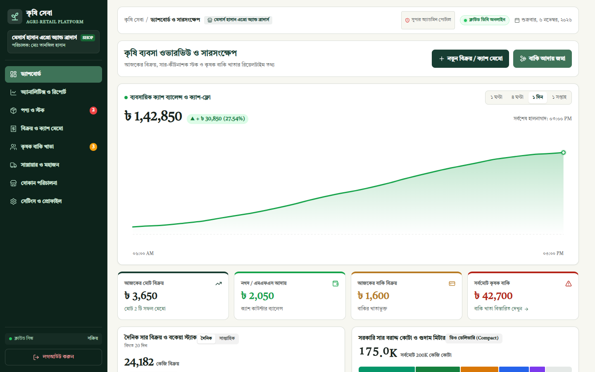
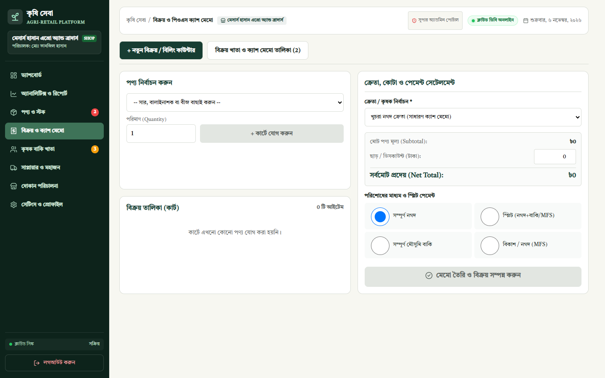
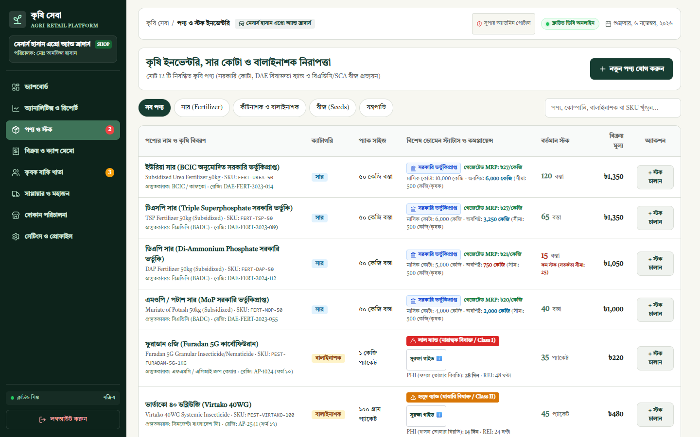
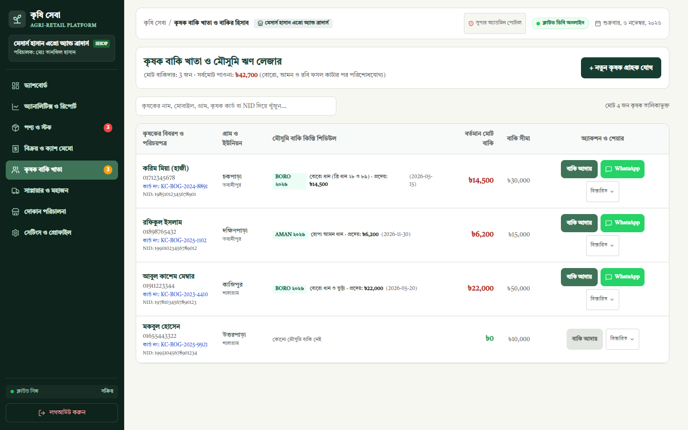
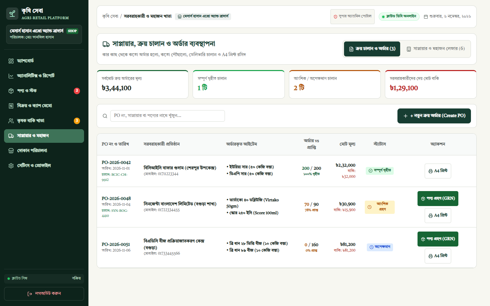
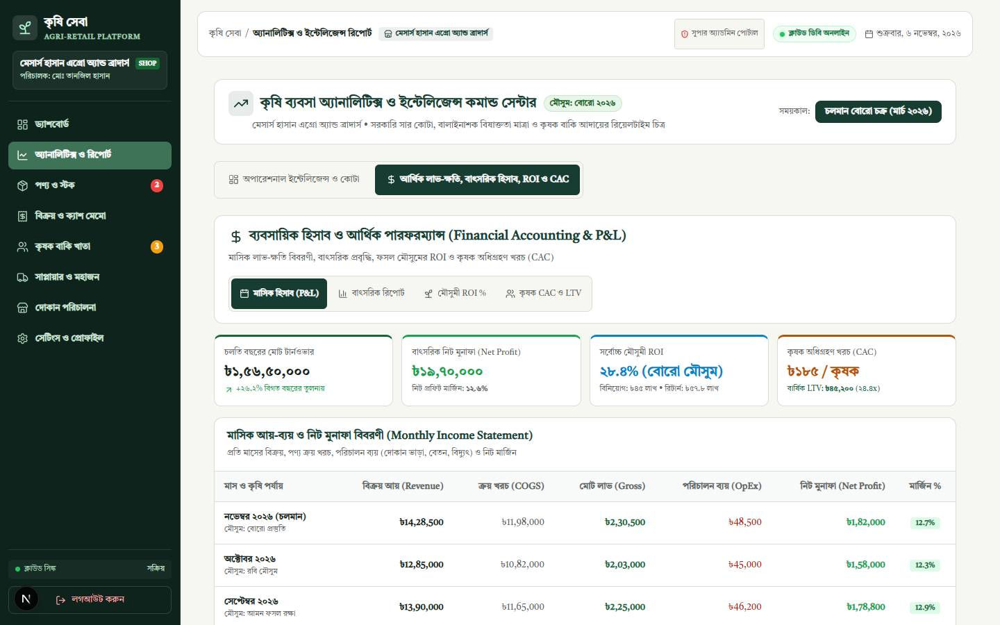
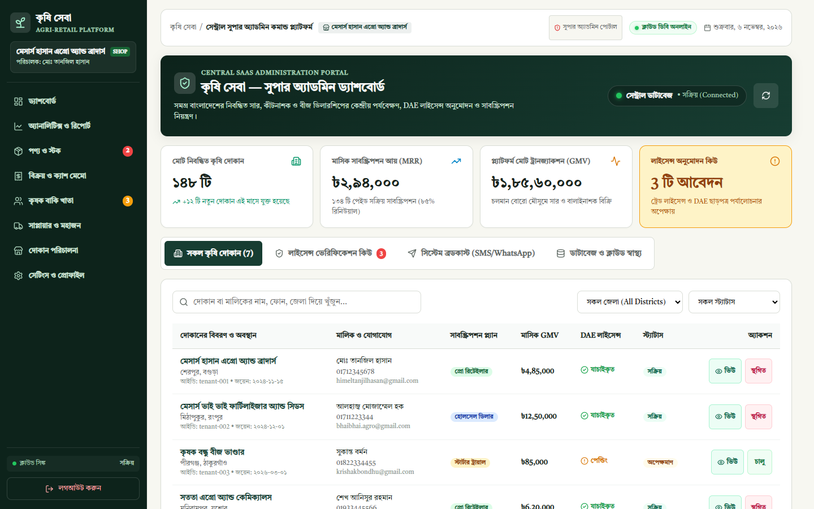

# Enterprise Case Study: Krishi Sheba (কৃষি সেবা)
**Subtitle:** Multi-Tenant Agricultural Retail Operations & Financial Platform  
**Author:** Tanjil Hasan Himel (Lead Product Architect & Systems Engineer)  
**Location:** Bangladesh  
**Classification:** Canonical Public Portfolio Case Study  

---

## Executive Summary

**Krishi Sheba** is a production-grade, multi-tenant software-as-a-service (SaaS) and retail operations platform engineered specifically for agricultural input dealers (fertilizers, pesticides, seeds, and farm machinery) across Bangladesh.

Serving a national market turnover exceeding **৳35,000 Crore ($3.2B USD)**, the platform replaces informal, paper-based "Red Khatas" with an automated operational engine that guarantees statutory compliance with the **Fertilizer Management Act (2006)**, the **Pesticide Act (2018)**, and the **Seed Act (2018)**.

---

## 1. Problem Statement & Ground Reality

In rural Bangladesh, over 150,000 agricultural input retailers operate at the fragile intersection of national food security, tight government price controls, and extreme working capital illiquidity:

1. **Strict Statutory Price Ceilings:** Retailers distribute government-subsidized fertilizers (Urea at ৳27/kg, TSP at ৳27/kg, DAP at ৳21/kg, MoP at ৳20/kg). Selling even one bag above gazetted prices exposes dealers to immediate mobile court magistrate fines (৳10,000 to ৳50,000) or dealership cancellation.
2. **Hazardous Chemical Liability:** Retailers dispense WHO Class I (Red) and Class II (Yellow) toxic pesticides. Failing to record batch lots or communicate Pre-Harvest Intervals (PHI) carries severe criminal liability.
3. **Seasonal Agro-Credit Mismatch:** Over 70% of farm inputs are purchased on credit during sowing and repaid only after harvest (3 to 5 months later). Western retail software based on 30-day invoices erroneously flags entire farming communities as defaulting debtors.
4. **Fragile Inbound Supply Chains:** Shipments from buffer godowns (BCIC) and distributors (Syngenta, Bayer, BADC) frequently arrive partially fulfilled. Lacking structured Goods Received Notes (GRN), dealers absorb massive shortage losses.

---

## 2. Product Management & Architecture Decisions

| Architectural Decision | Evaluated Alternative | Engineering Rationale |
| :--- | :--- | :--- |
| **Turborepo Monorepo (Next.js 16 + Fastify 5)** | Polyrepo / Separate microservices | Shared TypeScript validation schemas (`@krishi/contracts`) guarantee compile-time type safety across frontend and backend without version skew. |
| **Supabase PostgreSQL 17 with Engine-Level RLS** | Application-level tenant filtering | Zero-trust multi-tenancy. PostgreSQL enforces data isolation at query execution, preventing cross-dealer leaks. |
| **Native SVG Catmull-Rom Splines (`catmullRom.ts`)** | Heavy chart libraries (Recharts / Chart.js) | Saved >140KB bundle weight, eliminated React 19 hydration bugs, and enabled sub-pixel curve interpolation. |
| **Critically Damped Spring Mechanics (`useSpring`)** | Linear CSS transitions | Eliminates jarring visual updates during rapid counter rushes through physical damped harmonic oscillation ($\zeta = 1.0$). |
| **Decoupled Super Admin Route (`/superadmin`)** | In-app merchant tab switcher | Complete administrative boundary isolating nationwide dealership telemetry behind a Master PIN security gate (`7890`). |

---

## 3. Visual Verification Gallery

| Point of Sale & Regulatory Engine | Agrochemical Inventory & Quota Bounds |
| :---: | :---: |
|  |  |
| **Farmer Khata & Seasonal Harvest Cycles** | **Procurement & Goods Receipt Notes (GRN)** |
|  |  |
| **Periodic Financial Accounting & P&L** | **Central Super Admin Command Center** |
|  |  |

---

## 4. Measurable Outcomes & Unit Economics

- **Farmer Customer Acquisition Cost (CAC):** **৳185 / farmer**, calculated across grassroots community meetings (উঠান বৈঠক), local leaflet distribution, and seasonal SMS outreach.
- **Annual Farmer Lifetime Value (LTV):** **৳45,200 / year**, driven by repeat inputs across Boro (৳22,500), Aman (৳14,300), and Rabi (৳8,400) cycles.
- **LTV to CAC Ratio:** **24.4x**, confirming strong commercial and unit-level sustainability for retail input dealerships.
- **Automated Verification:** 304 automated tests passing across 14 test suites with 100% pass rate.

